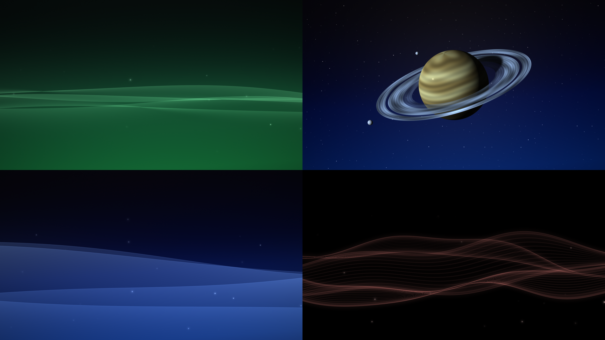

# Waves

A live wallpaper for [Omarchy](https://omarchy.org). Instead of playing a video, a
shader draws the picture on the GPU at your display's refresh rate, so it stays
sharp at any resolution, never loops, and follows your theme's colours.



## Styles

- **Silk**: thin translucent sheets that twist as they flow, in the spirit of classic game-console menus.
- **Bands**: broad, slow waves stacked on each other, each with a crisp crest.
- **Threads**: a twisting ribbon drawn as fine parallel lines.
- **Aurora**: soft curtains of light with no hard edges.
- **Saturn**: a ringed planet with drifting cloud bands and a wandering storm. The rings pass behind and in front of the globe, planet and rings shadow each other, and two moons orbit outside them.

## The menu

A palette icon in the bar opens the settings, with a live preview at the top:

- **Colour**: follow the theme's accent, pick one of twelve presets, or drag along the spectrum. A second colour tints the background, and Saturn's rings and moons.
- **OLED black**: a pure black background with only the wave or planet lit.
- **Particles**: drifting sparkles, or a starfield behind the planet.
- **Planet**: where Saturn sits and how big it is.
- **Motion**: speed (down to paused) and brightness.
- **Rendering**: frame rate, a lower frame rate while windows cover the workspace, and full or half resolution.
- **Presets**: save up to eight looks. *Remember per theme* keeps a separate look for each theme.
- **Extras**: show Waves on the lock screen, and update it whenever Omarchy updates. Both are off until you switch them on.

## Install

```bash
omarchy plugin add https://github.com/andershfranzen/omarchy-waves.git --enable
```

The wallpaper appears at once and the palette icon is added to the right side of the bar.

## Remove

```bash
omarchy plugin remove io.github.andershfranzen.waves
```

This removes the plugin and its bar icon; your normal background shows again.
Two files the plugin wrote are left behind and can be deleted:

- `~/.config/omarchy/waves.json`, your settings
- `~/.local/share/omarchy-waves/still.png`, a still of the current look

## What it touches

Out of the box:

- It draws on its own layer above your background and below every window. Your
  background setting is not changed.
- It writes only the two files listed above. The still is refreshed a few
  seconds after you change the look, in case you want a matching image
  elsewhere (set it yourself with `omarchy theme bg set`).
- It uses no network and runs no commands.

Only if you switch on an extra in the menu, `bin/waves` also:

- **Show on lock screen**: runs `omarchy plugin clone omarchy.lock`, adds one
  `Loader` to the clone's `LockView.qml`, and restarts the shell.
- **Update with Omarchy**: runs `omarchy plugin update` for Waves during
  `omarchy update`, which fetches from this repository.
- Either one installs `~/.config/omarchy/hooks/post-update.d/waves`, removed
  again when both are off.

Before removing the plugin, switch *Show on lock screen* off (or run
`bin/waves lock disable`) so the lock-screen clone goes with it.

## Settings file and commands

Everything in the menu is stored in `~/.config/omarchy/waves.json` and applied
live when the file changes, so it can be scripted. `Palette.js` lists every key
with its default. A few settings also have commands:

```bash
omarchy-shell waves setStyle silk|bands|threads|aurora|saturn
omarchy-shell waves setColor theme|#rrggbb
omarchy-shell waves setColor2 auto|#rrggbb
omarchy-shell waves setBlack true|false
omarchy-shell waves setParticles true|false
omarchy-shell waves setSpeed 0.5          # 0 to 4
omarchy-shell waves setBrightness 1.0     # 0.2 to 2.5
omarchy-shell waves-menu toggle           # open or close the menu, e.g. from a keybinding
```

## Performance

The shaders are cheap, but a wallpaper that moves makes the compositor redraw
the screen every frame. On an RTX 4070 at 3440x1440 and 240 Hz it costs about
6 W over idle. It stops drawing behind a fullscreen window, drops to 60 fps
while a workspace has windows open (changeable under *Rendering*), and freezes
when animations are turned off with `omarchy toggle animations`.

## On the lock screen

Switch on **Show on lock screen** under *Extras*, or run:

```bash
~/.config/omarchy/plugins/io.github.andershfranzen.waves/bin/waves lock enable
```

Omarchy's lock screen is a plugin of its own, and only a clone of it may act as
the lock screen. So Waves clones it and adds itself to the clone as a backdrop
over the usual blurred wallpaper; the password field and everything about
unlocking are Omarchy's code, untouched, and the backdrop is disabled for input
so it never sees what you type. Check the result without locking:

```bash
omarchy-shell lock preview      # and: omarchy-shell lock hidePreview
```

A clone would normally stop following Omarchy's lock-screen updates. To avoid
that, a post-update hook rebuilds the clone from the current stock lock screen
whenever `omarchy update` has changed it. If the stock lock screen ever changes
so that Waves no longer fits, the clone is removed, you are told, and the stock
lock screen is used. If Waves itself is missing or fails to load, the clone
shows the stock wallpaper.

If you already have your own lock-screen clone, Waves leaves it alone. Add this
to its `LockView.qml` yourself, after the `MultiEffect` that blurs the wallpaper:

```qml
Loader {
  anchors.fill: parent
  active: root.loadBackground
  enabled: false  // a backdrop only: it never receives keys or the pointer
  visible: status === Loader.Ready && item !== null && item.ready === true
  source: Qt.resolvedUrl("../io.github.andershfranzen.waves/WaveBackdrop.qml")
  onLoaded: {
    item.accent = Qt.binding(function() { return Commons.Color.accent })
    item.base = Qt.binding(function() { return Commons.Color.background })
    item.running = Qt.binding(function() { return root.loadBackground })
  }
}
```

## Updating

```bash
omarchy plugin update io.github.andershfranzen.waves
```

Or switch on **Update with Omarchy** under *Extras* to have `omarchy update` do
it. Changes are listed in [CHANGELOG.md](CHANGELOG.md).

## Requirements

- Omarchy 4 (the Quickshell-based Omarchy shell) on Hyprland.
- A GPU. Nothing else needs installing: the compiled shaders are in the repository.
- The two extras use `jq` and `git`, both part of Omarchy.

## Development

The shader sources are `wave.frag` and `final.frag`. After editing one, rebuild
it with the Qt shader tools (`qt6-shadertools`, already part of Omarchy):

```bash
/usr/lib/qt6/bin/qsb --qt6 -o wave.frag.qsb wave.frag
/usr/lib/qt6/bin/qsb --qt6 -o final.frag.qsb final.frag
```

`WaveScene.qml` is the whole picture as one component (settings in, animation
out); the wallpaper, the menu preview and the lock-screen backdrop all use it.

To release: bump `version` in `manifest.json`, add a section to `CHANGELOG.md`,
merge to `main`, and push a tag `v<version>`. The release workflow publishes a
GitHub release and files the marketplace's verification request for that commit
(it needs the `MARKETPLACE_TOKEN` secret described in
`.github/workflows/release.yml`).

## License

MIT. See [LICENSE](LICENSE).
